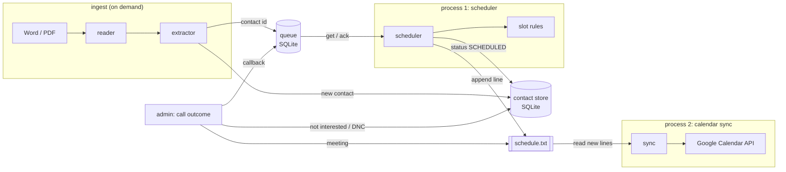

# FlowPilot

FlowPilot turns business-contact lists in Word or PDF documents into scheduled phone calls
in Google Calendar, and tracks what happens after each call.

```
Word / PDF ─► extract contacts ─► queue ─► scheduler ─► schedule.txt ─► calendar sync ─► Google Calendar
                                    ▲                                                          │
                                    └──── callback ◄──── admin records the call outcome ◄──────┘
```

## How the requirements are met

| Requirement | Implementation |
|---|---|
| Information is fed from a Word or PDF document | `reader.py` extracts text from `.docx` (paragraphs **and** tables, in order) and `.pdf`; `extractor.py` finds contacts in both table and `Label: value` layouts |
| Only business contacts are scheduled | A document counts as a contact document only if valid contacts are found; others queue nothing. Contacts without a valid phone number are skipped with a reason |
| Fed into a queue, popped one by one | `message_queue.py`: a persistent FIFO queue (SQLite) with get → ack, so a crash never loses a message |
| Scheduled into a text file at a 15-minute interval (configurable) | `scheduler.py` + `slots.py` write one JSON line per call to `data/schedule.txt`; interval, call length, working hours and days are set in `config.toml` |
| The text file is read by another process and scheduled into Google Calendar | `calendar_sync.py` runs as a separate process (`sync --watch`) and creates one event per new line |
| Asked to call again in days / weeks / months → reschedule | `callback --in "2 weeks"`: the contact goes back through the queue and gets the first free slot on or after that date |
| Not interested / asked not to call → mark and classify with remarks | `not-interested --remark ...` → `NOT_INTERESTED`; with `--do-not-call` → `DO_NOT_CALL`. Both are final states, and a contact in either state is never queued again, even if they appear in a new document |
| Interested → schedule a physical meeting | `meeting --at ... --location ...` → `MEETING_BOOKED`, and a meeting event with location is added to the calendar |

## Architecture



The scheduler and the calendar sync are **independent processes**. Their only connection is
`schedule.txt`, so either one can be stopped, restarted or replaced without affecting the other.

### Contact life cycle

Every status change goes through one method (`Contact.transition_to`) that checks a table of
allowed transitions and records a timestamped remark, so each contact has a full history.

```
NEW ──► SCHEDULED ──► CALLBACK_REQUESTED ──► SCHEDULED (again)
            ├──► NOT_INTERESTED   (final)
            ├──► DO_NOT_CALL      (final)
            └──► MEETING_BOOKED   (final)
```

### Modules

| Module | Responsibility |
|---|---|
| `config.py` | Loads and validates `config.toml` |
| `models.py` | `Contact` and its status state machine |
| `reader.py` | Document → plain text |
| `extractor.py` | Plain text → validated contacts (phone numbers normalised to E.164) |
| `contact_store.py` | Single source of truth for contacts and their status |
| `message_queue.py` | Persistent FIFO queue (`SQLiteQueue`; `InMemoryQueue` for tests) |
| `ingest.py` | Document → contact store + queue |
| `slots.py` | Pure time-slot rules: rounding, working hours, weekends, clashes |
| `schedule_file.py` | Reading and appending `schedule.txt` |
| `scheduler.py` | Queue → slot → `schedule.txt` |
| `calendar_client.py` | Calendar interface, Google implementation, fake for tests |
| `calendar_sync.py` | `schedule.txt` → calendar events |
| `outcomes.py` | Callback, not interested / do not call, meeting |
| `cli.py` | Command-line interface (thin layer over the modules above) |

### The schedule file

JSON Lines: one complete JSON object per line, for example

```json
{"entry_id": "355a12d0…", "type": "call", "contact_id": "0d9ebee6", "name": "Nimal Perera", "company": "Lanka Tech Solutions", "phone": "+94771234567", "email": "nimal.perera@example.com", "start": "2026-11-27T16:00:00+05:30", "duration_minutes": 15, "created_at": "2026-11-27T15:52:00+05:30", "location": "", "note": ""}
```

It is still a plain text file, but each line can be parsed on its own, values such as company
names may contain commas, and a line damaged by a crash affects only that line.

## Design decisions

- **Persistent queue with acknowledgement.** `get` only hides a message; it is deleted by
  `ack` after the work has succeeded. Messages left in progress by a crash are recovered on
  the next start. The queue is defined as an interface, so it can be replaced by RabbitMQ,
  Redis or a cloud queue without changing the scheduler.
- **Idempotent steps.** Every queue message has a unique id that becomes the schedule entry
  id, and the calendar event id is derived from it. Re-processing after a crash therefore
  never creates a second schedule line or a second calendar event.
- **Write, then acknowledge.** The scheduler writes the schedule line (flushed to disk), then
  updates the contact store, then acknowledges the message. A crash at any point can only lead
  to a retry, never to a lost contact.
- **Free-slot scheduling.** A new call takes the first free slot from now; a callback takes the
  first free slot on or after its requested date. A callback booked weeks ahead therefore does
  not push today's new contacts back.
- **Calendar months are clamped.** "In 1 month" from 31 January is 28/29 February.
- **Contact store as the single source of truth.** Queue messages carry only the contact id.
  The phone number is `UNIQUE` in the database, so the same person cannot be added twice, and
  people marked `DO_NOT_CALL` are protected when they appear in later documents.
- **Least privilege.** The app requests only the `calendar.events` permission. OAuth
  credentials and tokens are git-ignored.
- **Fail fast on bad input.** Invalid configuration, dates, delays or status changes are
  rejected with a clear message before anything is changed.

## Limitations and next steps

- **Public holidays** are not skipped yet. They could come from a list in `config.toml` or from
  the Google "Holidays in Sri Lanka" calendar.
- **Recording an outcome before the scheduled call time** leaves that call's calendar event in
  place. A `cancel` entry type in `schedule.txt` would let the sync process delete it.
- **Meetings do not block call slots.** Whether they should depends on who makes the calls.
- **Scanned PDFs** (images without text) would need OCR. Old binary `.doc` files are not
  supported; they can be converted to `.docx` first.
- **Concurrent edits** of the same contact by two admins: the last save wins. Optimistic locking
  (a version number per contact) would detect this.
- **Contacts are matched by phone number only.** Two people sharing an office number are
  treated as the same contact.
- A small web dashboard could be added on top of the same modules the CLI uses.

## Setup

Requires Python 3.11+.

```bash
python3 -m venv .venv
source .venv/bin/activate
pip install -r requirements.txt
python -m flowpilot --help
```

Settings live in `config.toml` (interval, working hours, timezone, file paths).

### Google Calendar (one time)

1. Open <https://console.cloud.google.com/> and create a project.
2. **APIs & Services → Library** → "Google Calendar API" → **Enable**.
3. **OAuth consent screen** → **External** → app name and email → add your Google account
   under **Test users**.
4. **Credentials → Create credentials → OAuth client ID** → **Desktop app** → **Download JSON**.
5. Save the file in the project folder as `credentials.json`.
6. Run `python -m flowpilot sync`. A browser window opens once to sign in; the resulting
   `token.json` is reused afterwards.

## Usage

```bash
# Read documents: business contacts are saved and queued
python -m flowpilot ingest samples/contacts.docx samples/contacts.pdf

# Scheduler: give each queued contact a call slot in data/schedule.txt
python -m flowpilot schedule

# Calendar sync: create a Google Calendar event for each new schedule entry
python -m flowpilot sync

# Contacts and their status
python -m flowpilot list
python -m flowpilot list --status not_interested
python -m flowpilot show <contact-id>
```

### Recording call outcomes

```bash
python -m flowpilot callback <contact-id> --in "2 weeks" --remark "Busy until year-end"
python -m flowpilot not-interested <contact-id> --remark "Already has a supplier"
python -m flowpilot not-interested <contact-id> --remark "Asked not to be called" --do-not-call
python -m flowpilot meeting <contact-id> --at "2026-12-02 14:00" --location "Their office" --remark "Wants a demo"
```

Callbacks go back through the queue, so they are booked by the next `schedule` run.

### Running continuously

Run each process in its own terminal:

```bash
python -m flowpilot schedule --watch
python -m flowpilot sync --watch
```

## Sample documents

`samples/` holds generated documents with fictional contacts: a Word file with a contact
table, a PDF with labelled contact blocks, and a Word file with meeting notes and no contacts.
Recreate them with `python scripts/make_samples.py` (needs `requirements-dev.txt`).

## Tests

```bash
pip install -r requirements-dev.txt
python -m pytest                        # 122 tests
python -m pytest --cov=flowpilot        # coverage (about 90%)
ruff check .                            # linting
```

The tests use a fake calendar and temporary files, so they need no network access or Google
account. They cover the slot rules, crash recovery, duplicate protection, all three call
outcomes and the full flow through the command line.

## Project structure

```
flowpilot/      application code (see Modules above)
tests/          pytest suite
samples/        sample Word and PDF documents
scripts/        sample document generator
config.toml     settings
data/           runtime data: queue, contact store, schedule.txt (git-ignored)
```
